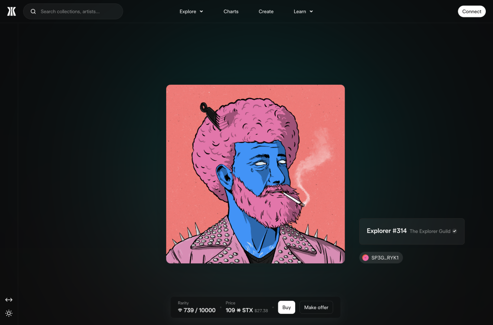

import { Aside, Steps } from "@astrojs/starlight/components";

[The Explorer Guild](https://www.explorerguild.io/) is Sigle's official collection of 3,000 hand-drawn NFTs on the Stacks blockchain, inspired by Jules Verne. Holding any Explorer Guild NFT in your wallet unlocks **Sigle Pro** with no recurring subscription fees.

## What Sigle Pro includes

- Everything in Free
- Custom domain _(coming soon)_
- Upload images and cover images
- Verified Explorer Guild badge
- Early access to new features

## Buying an Explorer NFT

<Steps>

1. **Set up a Stacks wallet**

   Install a Stacks-compatible wallet such as [Leather](https://leather.io/) (browser extension) or [Xverse](https://www.xverse.app/) (browser extension and mobile app).

   Create a wallet and store your secret recovery phrase safely offline — never share it with anyone. If you already write on Sigle, use the same wallet you sign in with, since Sigle verifies NFT ownership on that wallet.

2. **Add STX to your wallet**

   Explorer Guild NFTs are traded in **STX**, the native token of the Stacks blockchain. You can get STX in two ways:

   - **From an exchange**: Buy STX on an exchange (such as Coinbase, Kraken, Binance, or OKX) and withdraw it to your Stacks address (which starts with `SP...`). Self-custody wallets do not require a memo.
   - **Directly in your wallet**: Use the built-in buy option inside Leather or Xverse.

   Make sure to include a little extra STX (for example, 1 STX) on top of the NFT price to cover Stacks network transaction fees.

3. **Connect your wallet to Gamma**

   Open [The Explorer Guild collection on Gamma](https://gamma.io/stacks/collections/the-explorer-guild/items), the primary NFT marketplace on Stacks.

   Click **Connect** in the top-right corner, select Leather or Xverse, and approve the connection request in your wallet.

   <Aside type="tip" title="Verify the collection">
     Always check that you are browsing the official Explorer Guild contract on
     Stacks mainnet:
     `SP2X0TZ59D5SZ8ACQ6YMCHHNR2ZN51Z32E2CJ173.the-explorer-guild`.
   </Aside>

4. **Choose and buy an Explorer**

   Browse the available NFTs — you can sort by lowest price or filter by traits. Every Explorer Guild NFT unlocks the exact same Sigle Pro features regardless of rarity or traits.

   Select the Explorer you want and click **Buy** (or **Make offer** if you want to bid below the listed price). Review the total price and network fee in your wallet popup, then click **Confirm**.

   

   Wait for the transaction to confirm on the Stacks blockchain. This typically takes from a few seconds up to a few minutes. Once confirmed, the NFT will appear in your wallet.

5. **Activate Pro on Sigle**

   Sign in to [Sigle](https://www.sigle.io/) with the wallet holding your Explorer Guild NFT and open **Dashboard → Plan** (`sigle.io/dashboard/plan`).

   Under **Activate Pro**, click **Check my wallet**. (If you opened Gamma directly from the Plan page, Sigle also checks your wallet automatically when you return to the tab.)

   <Aside type="note">
     If Sigle reports that no Explorer Guild NFT was found right after your
     purchase, wait a few minutes for the transaction to finalize on Stacks and
     click **Check my wallet** again.
   </Aside>

</Steps>

## Frequently asked questions

### What happens if I sell or transfer my Explorer NFT?

Pro stays active as long as your wallet holds an Explorer Guild NFT. If you sell or transfer it, your account returns to the Free plan. Your published posts stay online, and you can activate Pro again anytime by holding an Explorer NFT.
